# La IA no te va a quitar el trabajo · CINCIT 2026

Material de la charla de **Roberto Gutiérrez Brown** en el CINCIT 2026 (Universidad Nacional José María Arguedas, Andahuaylas) y del juego interactivo que la acompaña.

**La idea:** los asistentes escanean un QR y responden **8 preguntas anónimas** desde el celular. Un panel proyectado muestra los resultados en vivo y, al final, **3 insights** que Claude redacta con las respuestas de la propia sala.

## Qué se ve

**1. Lo que ve el alumno en su celular** (90 segundos, sin nombre, correo ni DNI)

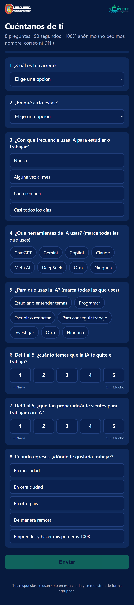

**2. Lo que ve la sala en la pantalla** (9 pantallas, una idea por pantalla; capturas del evento real, con datos agrupados)

| | |
|---|---|
| 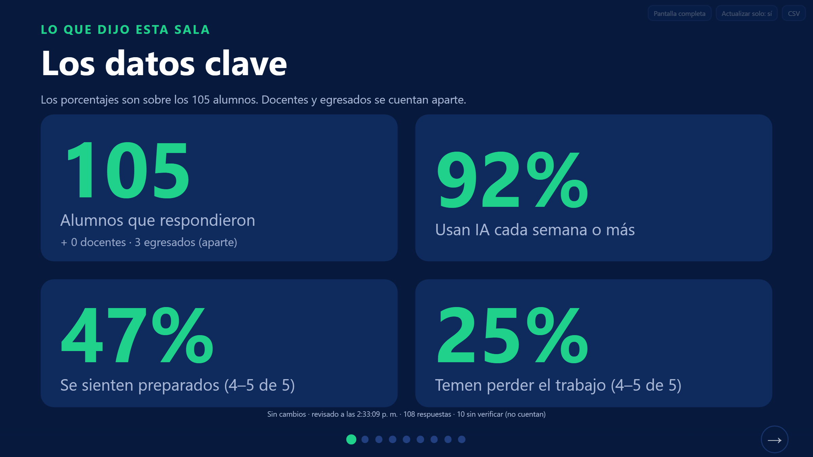 | 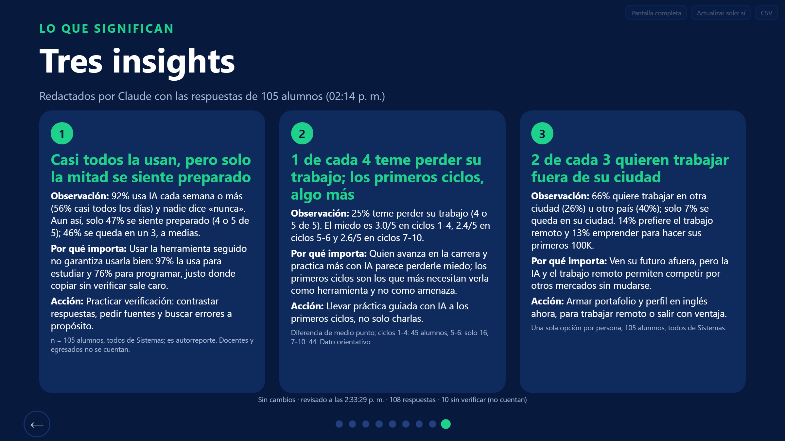 |
| Los datos clave | Los tres insights (última pantalla) |

<details>
<summary>Ver las otras 7 pantallas del panel</summary>

| | |
|---|---|
| 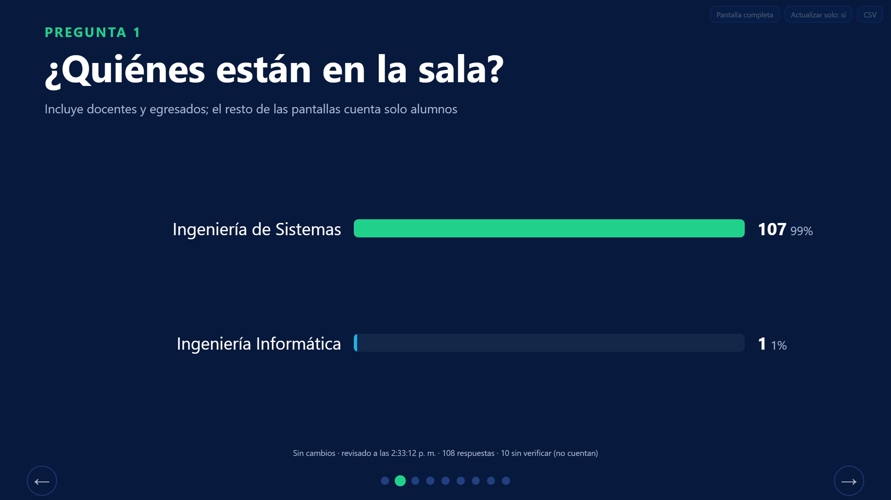 | 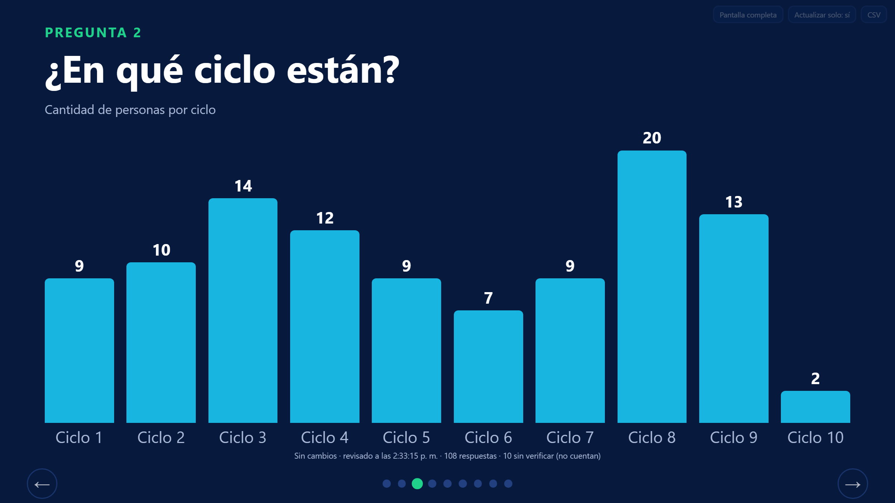 |
| 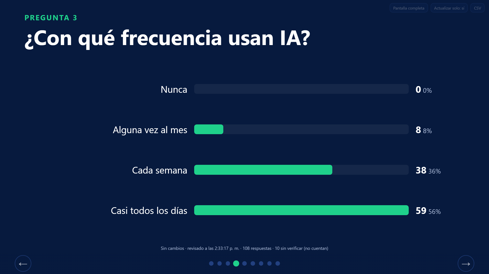 | 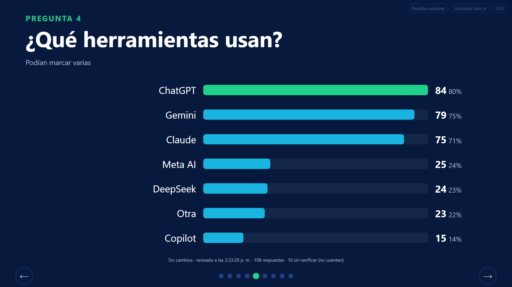 |
| 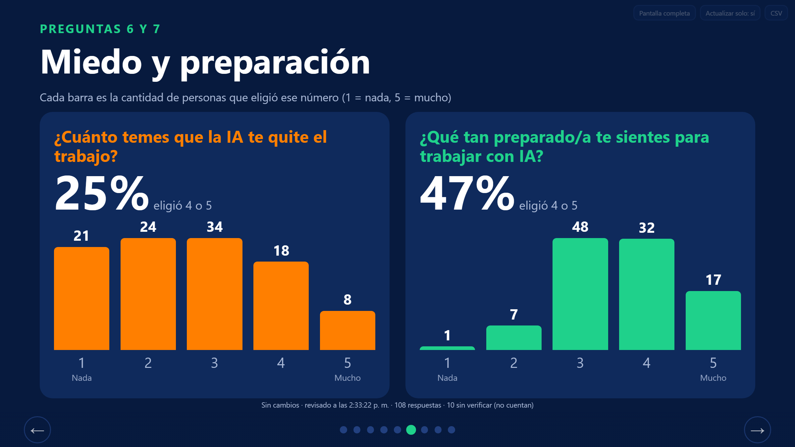 | 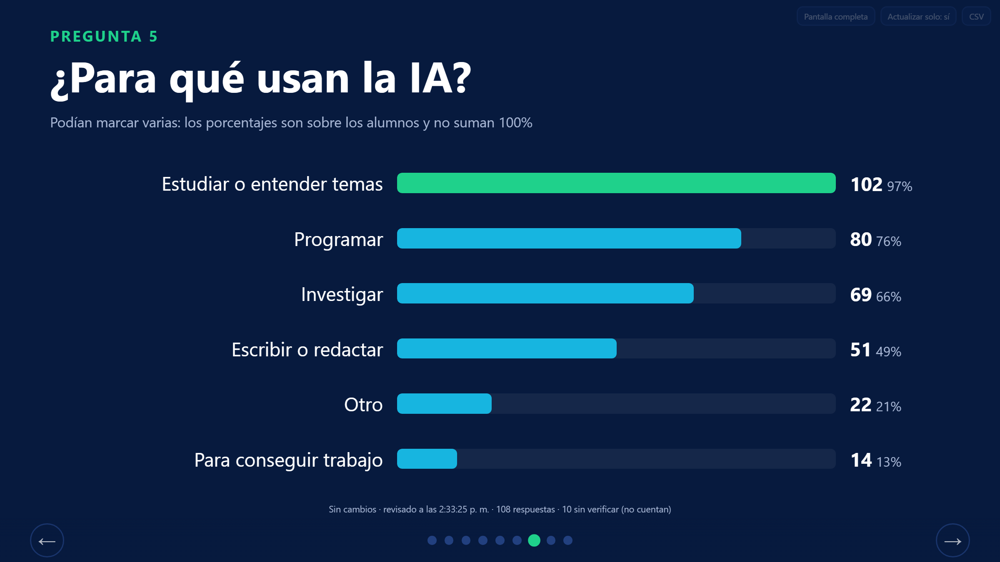 |
| 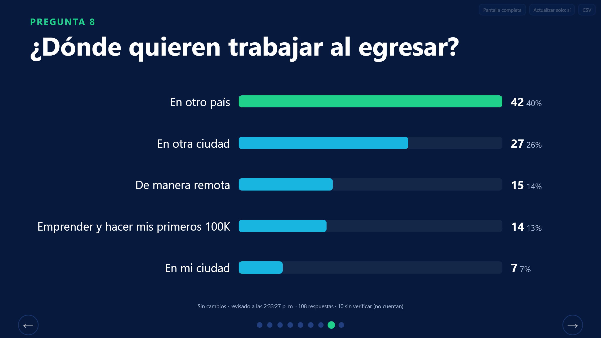 | |

</details>

## Cómo está organizado el repositorio

| Carpeta | Qué contiene |
|---|---|
| [`encuesta/`](encuesta) | La aplicación: Worker de Cloudflare, formulario, panel y herramientas de línea de comandos |
| [`docs/`](docs) | Arquitectura, guía del juego, estructura de la charla y guion del orador |
| [`charla/`](charla) | La presentación (`.pptx`), su generador, imágenes, QR y scripts de ensayo |

## Arquitectura

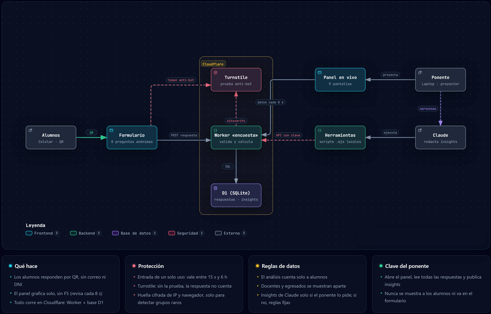

Versión interactiva (zoom, tema claro u oscuro, exportar): [`docs/arquitectura_encuesta.html`](docs/arquitectura_encuesta.html). Descárgala y ábrela en el navegador. Está hecha con [Archify](https://github.com/tt-a1i/archify) y su fuente editable es `docs/arquitectura_encuesta.archify.json`.

- **Formulario y panel**: páginas estáticas (`encuesta/public`) servidas por el mismo Worker.
- **Worker** (`encuesta/src/worker.js`): valida las respuestas, aplica la protección y calcula los datos.
- **D1**: guarda respuestas, insights publicados y las entradas ya usadas.
- **Herramientas** (`encuesta/herramientas`): scripts que leen las respuestas, publican insights y revisan respuestas sospechosas. Se usan con la clave del ponente.

---

# Paso a paso

## A. Preparación (una sola vez, 1 o 2 días antes)

Necesitas **Node.js 20 o superior**, una cuenta gratuita de **Cloudflare** y un widget de **Turnstile** (gratis, desde el panel de Cloudflare).

1. **Instala las dependencias**
   ```bash
   cd encuesta
   npm install
   ```
2. **Inicia sesión en Cloudflare**
   ```bash
   npx wrangler login
   ```
3. **Crea la base de datos** y copia el `database_id` que te devuelve en `wrangler.jsonc`:
   ```bash
   npx wrangler d1 create cincit-encuesta
   npx wrangler d1 execute cincit-encuesta --remote --file schema.sql
   ```
4. **Pon la clave pública de Turnstile** en `TURNSTILE_SITEKEY`, dentro de `wrangler.jsonc`.
5. **Guarda los dos secretos.** El comando te pide el valor y nunca van al repositorio:
   ```bash
   npx wrangler secret put ADMIN_KEY          # tu clave de ponente: elige una que puedas escribir rápido
   npx wrangler secret put TURNSTILE_SECRET   # el secreto del widget de Turnstile
   ```
6. **Publica**
   ```bash
   npx wrangler deploy
   ```
   Al terminar, Wrangler muestra la dirección, algo como `https://encuesta.TU-SUBDOMINIO.workers.dev`.
7. **Crea tu archivo de accesos.** Copia `encuesta/ACCESOS.example.txt` como `encuesta/ACCESOS.txt` y completa la dirección y la clave. Las herramientas leen de ahí. El archivo está en `.gitignore`, así que no se sube.
8. **Genera el QR** con la dirección del formulario (`charla/juego/make_qr.py`), reconstruye la presentación (`charla/build/build_deck.js`) y confirma que el QR aparece en la diapositiva 2.

## B. Ensayo (el día anterior)

1. **Abre el formulario en tu celular con datos móviles** (no con tu Wi-Fi) y envía una respuesta de prueba.
2. **Abre el panel:** `https://TU-DIRECCION/panel#k=TU_CLAVE`. Comprueba que la respuesta aparece sin apretar F5. Si queda como «sin verificar», mira «Si algo falla».
3. **Ensaya los insights** con datos inventados:
   ```bash
   cd encuesta
   node herramientas/sembrar_demo.mjs 30      # mete 30 respuestas INVENTADAS
   node herramientas/leer_respuestas.mjs      # resumen solo de alumnos
   ```
   Redacta 3 insights (el formato está en `docs/Guia_del_juego.md`) y publícalos:
   ```bash
   node herramientas/publicar_insights.mjs insights.json
   ```
   En unos 8 segundos aparecen en la última pantalla del panel.
4. **Borra TODO lo de prueba** antes del evento. Es obligatorio: si no, se mezcla con las respuestas reales.
   ```bash
   curl -X DELETE "https://TU-DIRECCION/api/datos?confirmar=SI&key=TU_CLAVE"
   curl "https://TU-DIRECCION/api/datos?conteo=1"      # debe responder {"n":0,"sv":0,"v":""}
   ```

## C. El día de la charla

| Cuándo | Qué haces |
|---|---|
| **Minuto 0** | Proyecta la diapositiva 2 con el **QR** y el enlace escrito, para quien no pueda escanear. Deja la laptop despierta y con internet estable. |
| **Mientras responden** | Mira el contador (`/api/datos?conteo=1`) o el panel. Apunta a **30 o más** respuestas; con menos, los porcentajes dicen poco. |
| **Con ~20 respuestas o más** | Pide los insights: dile a Claude «procesa». Claude corre `leer_respuestas.mjs`, redacta 3 insights con los números reales y los publica. Tarda uno o dos minutos. Para actualizarlos con más gente: «actualiza». |
| **Minuto ~31** | Abre el panel, pon pantalla completa con `F` y avanza con las flechas. Los insights son la **última pantalla**; léelos como *observación → por qué importa → acción*. |
| **Cierre** | Vuelve a la diapositiva final: la IA hizo el trabajo pesado, tú decides qué significa. |

**Teclas del panel:** `→` `↓` `Espacio` siguiente · `←` `↑` anterior · `Inicio` y `Fin` · `F` pantalla completa. En celular o tablet, deslizar el dedo.

**Importante al hablar:** los insights son de Claude solo si se publicaron con el paso anterior. Si no, el panel muestra cálculos de reglas fijas y no hay IA en vivo.

## D. Después de la charla

1. **Descarga las respuestas** antes de borrar nada: botón **CSV** del panel, o `https://TU-DIRECCION/api/datos?format=csv&key=TU_CLAVE`. Guárdalas fuera del repositorio.
2. **Borra la base de datos** si no la necesitas: el mismo `curl -X DELETE` de arriba.
3. **Opcional:** apaga el sitio con `npx wrangler delete` para que no quede publicado.

---

## Si algo falla

| Problema | Qué hacer |
|---|---|
| El panel pide clave | Usa `https://TU-DIRECCION/panel#k=TU_CLAVE`. Ábrelo desde la dirección web, **no** desde el archivo `panel.html` de tu disco. |
| El panel dice «N sin verificar» | Corre `node herramientas/revisar.mjs`. Si parecen personas normales (distintas entre sí, repartidas en el tiempo): `node herramientas/revisar.mjs aprobar --sin-verificar`. Si son bots o copias: `borrar --sin-verificar` o `borrar --duplicadas`. |
| Muchos alumnos reales quedan «sin verificar» | Apaga Turnstile: `npx wrangler secret delete TURNSTILE_SECRET` y publica de nuevo con `npx wrangler deploy`. El sitio vuelve a aceptar respuestas sin esa prueba. |
| No alcanzas a publicar los insights | El panel sigue mostrando los de reglas fijas: nunca queda vacío. Para volver a ellos: `node herramientas/publicar_insights.mjs --borrar`. |
| No cargan los datos ni la página | Plan B: usa `charla/juego/ensayo/dashboard.html` aclarando que son datos de ejemplo, o la diapositiva de explicación. |

## Reglas importantes

- **Solo alumnos cuentan.** Docentes y egresados pueden responder, pero el panel y los insights los dejan aparte.
- **Protección contra bots y repetidos**, sin pedir correo ni DNI: una entrada de un solo uso (entre 15 s y 6 h), Cloudflare Turnstile y una huella cifrada de IP y navegador. Las respuestas sin verificar se guardan, pero no cuentan hasta aprobarlas.
- **Lo que no se puede evitar:** alguien con varios celulares reales, uno por uno, sigue pudiendo responder varias veces.
- **No es una encuesta representativa:** es autorreporte de quienes escanearon el QR.

## Desarrollo local

Crea `encuesta/.dev.vars` (está en `.gitignore`):

```
ADMIN_KEY=una-clave-de-prueba
TURNSTILE_SECRET=1x0000000000000000000000000000000AA
```

La segunda línea es el secreto de prueba de Turnstile, que siempre aprueba. Luego `npx wrangler dev --local`. Para usar las herramientas contra el servidor local, agrega `--base http://localhost:8787 --key una-clave-de-prueba`.

En [`encuesta/ejemplos/respuestas_DEMO_inventadas.csv`](encuesta/ejemplos/respuestas_DEMO_inventadas.csv) hay 128 respuestas **inventadas** (mismo formato que la exportación real) para probar análisis sin datos de personas. No representan a nadie.

## Privacidad

No se pide nombre, correo, teléfono ni DNI. Cada respuesta lleva un identificador aleatorio y la hora. Este repositorio **no incluye respuestas individuales**, claves ni archivos de acceso; las capturas del panel muestran solo resultados agrupados.

## Más documentación

- [`docs/Guia_del_juego.md`](docs/Guia_del_juego.md): guía detallada del juego.
- [`docs/Estructura_charla.md`](docs/Estructura_charla.md) y [`docs/Guion_del_orador.md`](docs/Guion_del_orador.md): contenido de la charla.

## Limitaciones conocidas

- Los scripts de `charla/juego/` (`dashboard_asistentes.py`, `generar_respuestas_demo.py`) son de una versión anterior del formulario y no reflejan las preguntas actuales.
- `charla/build/build_deck.js` regenera la presentación; la versión final es el `.pptx` de `charla/`.
